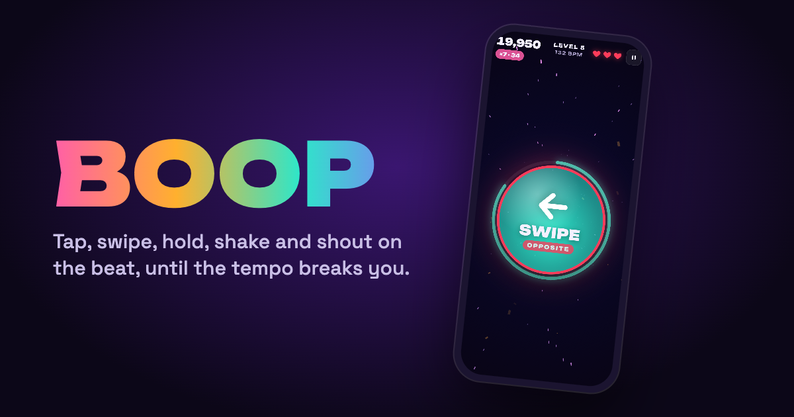

# BOOP

**[Play it →](https://hughtures.github.io/boop-it/)**

A rhythm reflex game you play with your whole phone. The pad calls out a move and you have until the ring runs out. Every 8 hits the tempo rises, the music changes key and the window shrinks, until you break.



## Moves

| Command | Touch | Keyboard |
|---|---|---|
| BOOP | Tap | Space |
| BOOP BOOP | Double-tap | Space ×2 |
| HOLD | Press and hold until the pad fills | Hold Space |
| SWIPE ← (and OPPOSITE, from level 5) | Swipe | Arrow keys |
| SHAKE | Shake the phone (motion sensor) or scribble | S |
| FREEZE | Don't touch anything | |
| SHOUT (opt-in) | Make noise into the mic | X |

## How it works

- **No audio files.** Every sound, including the drums, bass, arpeggio, pads and sound effects, is synthesized live with the Web Audio API ([`js/audio.js`](js/audio.js)). Each command has its own sound, so you can play by ear.
- **Beat-locked timing.** The music runs on a lookahead step sequencer that schedules notes about 120 ms ahead on the audio clock. It reports each beat's exact timestamp, so commands and visuals land on the beat instead of on whenever a timer happens to fire. Tempo changes wait for the next bar line.
- **One input layer** ([`js/input.js`](js/input.js)) turns pointer gestures (tap, swipe, hold, and scribble-as-shake), the keyboard, `devicemotion` and microphone loudness (with an adaptive noise floor) into one small set of events. The game judges each event against the current command, so a double-tap never has to wait to rule out a single tap.
- **Fair under pressure.** Motion and mic only count when the game asks for them, so a noisy room can't fail an unrelated command. If a slow frame delays a command, its window shifts so you still get the full time.
- **Daily mode.** A PRNG seeded with the date gives everyone the same command sequence that day, with a shareable emoji result.
- **Polish.** Canvas starfield and particles, screen shake, haptics, screen wake lock, `prefers-reduced-motion` support, and a pause when the tab is hidden.
- **Installs to a phone and works offline** through a service worker.

Plain JavaScript modules: no frameworks, no build step, no dependencies.

## Run locally

```bash
python3 -m http.server 8000
```

Then open http://localhost:8000.
